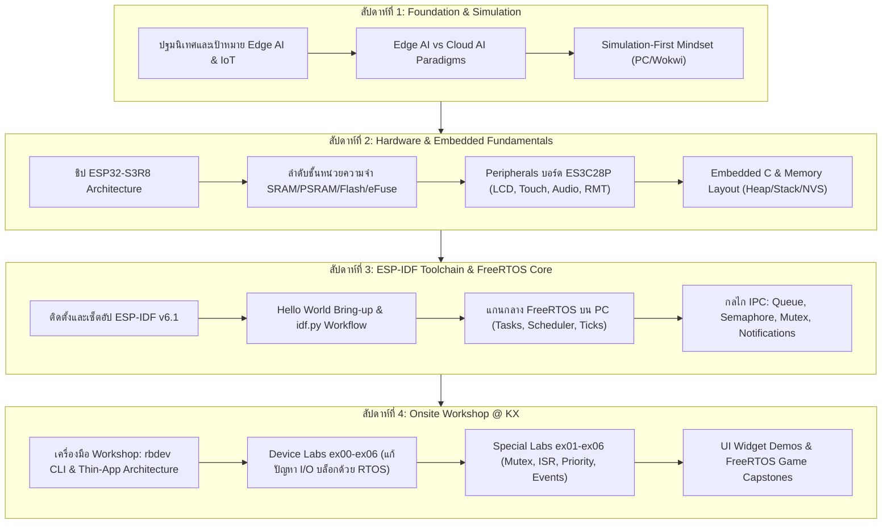

# รายงานสรุปผลการเรียนรู้รายสัปดาห์ (Week 01 – Week 04)

## โครงการบัณฑิตพันธุ์ใหม่ (Non-Degree) รุ่นที่ 2 ประจำปี 2569 — มหาวิทยาลัยเทคโนโลยีพระจอมเกล้าธนบุรี (KMUTT)
### หลักสูตร ND01: นักพัฒนาอุปกรณ์ Edge AI และ IoT ที่มีความปลอดภัย (Edge AI and Secure IoT Device Developer)
- **ผู้สอน:** ผศ. ดร. สันติ นุราช (Asst. Prof. Dr. Santi Nuratch) | ภาควิชาวิศวกรรมระบบควบคุมและเครื่องมือวัด (INC-KMUTT)
- **รวบรวมและจัดทำโดย:** ผู้เข้าอบรมหลักสูตร ND01

---

## สารบัญแยกตามรายสัปดาห์ (Weekly Modules: Week 01 – Week 04)

เอกสารสรุปผลการเรียนรู้ถูกแยกออกเป็นรายสัปดาห์เพื่อให้สะดวกต่อการศึกษารายหัวข้อและการส่งมอบงาน สามารถคลิกเลือกอ่านแต่ละสัปดาห์ได้จากตารางด้านล่าง:

| สัปดาห์ | หัวข้อการเรียนรู้หลัก | ลิงก์เอกสารสรุป |
| :---: | --- | :---: |
| **Week 01** | **ปฐมนิเทศ พื้นฐาน Edge AI & IoT และสภาพแวดล้อมการจำลอง** • วัตถุประสงค์โครงการและเกณฑ์การประเมินผล • แนวคิด Edge AI vs Cloud AI ในระบบสมองกลฝังตัว • กระบวนการคิดแบบ Simulation-First Paradigm | [📄 เปิดอ่าน Week 01](week01/README.md) |
| **Week 02** | **สถาปัตยกรรมชิป ESP32-S3R8 ฮาร์ดแวร์ ES3C28P และวงจรเชื่อมต่อ** • ซีพียู Xtensa Dual-Core LX7 & Vector Instructions • ลำดับชั้นหน่วยความจำ (ROM, SRAM, Octal PSRAM, Flash, eFuse) • การจองหน่วยความจำ `heap_caps_malloc` & Partition Table • กับดัก Native USB-Serial, วงจรจ่ายไฟ และอุปกรณ์ต่อพ่วงบนบอร์ด ES3C28P | [📄 เปิดอ่าน Week 02](week02/README.md) |
| **Week 03** | **การติดตั้ง ESP-IDF v6.1 และแกนกลาง FreeRTOS บนเครื่องคอมพิวเตอร์** • สถาปัตยกรรมทูลเชน ESP-IDF (CMake, Ninja, Python Venv) • การคอมไพล์ แฟลช และมอนิเตอร์โปรเจกต์ Hello World บน ESP32-S3 • ทฤษฎี Preemptive Multitasking & FreeRTOS Task States • กลไกสื่อสารระหว่างทาสก์ (Queue, Mutex, Semaphore, Event Group, Task Notify) | [📄 เปิดอ่าน Week 03](week03/README.md) |
| **Week 04** | **ปฏิบัติการ Onsite Workshop @ อาคาร KX มจธ. (Firmware Engineering Labs)** • การใช้งานเครื่องมือ `rbdev` CLI และสถาปัตยกรรม Thin-App • เจาะลึก Device Labs (ex00 – ex06): แก้ปัญหาฮาร์ดแวร์บล็อกด้วย FreeRTOS • ปฏิบัติการ Special Labs (ex01 – ex06), UI Demos และ RTOS Game Capstones | [📄 เปิดอ่าน Week 04](week04/README.md) |

---

## ภาพรวมเส้นทางการเรียนรู้ (Learning Roadmap)

การเรียนรู้ตลอดระยะเวลา 4 สัปดาห์แรกของหลักสูตร **ND01: นักพัฒนาอุปกรณ์ Edge AI และ IoT ที่มีความปลอดภัย** ได้วางรากฐานทางวิศวกรรมสมองกลฝังตัว (Embedded Systems Engineering) อย่างเข้มข้น โดยเน้นการผสมผสานระหว่างภาคทฤษฎีฮาร์ดแวร์ระดับซิลิคอน, การบริหารจัดการหน่วยความจำ, สถาปัตยกรรมระบบปฏิบัติการเวลาจริง (Real-Time Operating System: FreeRTOS) ตลอดจนการพัฒนาเฟิร์มแวร์เชิงโครงสร้างบนบอร์ดไมโครคอนโทรลเลอร์สมรรถนะสูง **ESP32-S3**

---

## บทสรุปทักษะทางวิศวกรรมที่ได้รับ (Key Engineering Competencies)

1. **Hardware-Software Co-Design:** สามารถอ่านและทำความเข้าใจวงจรเชื่อมต่อ การเลือกชนิดหน่วยความจำ (SRAM vs PSRAM) การหลีกเลี่ยงข้อจำกัดของขา Strapping Pin และเข้าใจโครงสร้างภายในของ ESP32-S3 อย่างถ่องแท้ ([อ่านเพิ่มเติมใน Week 02](week02/README.md))
2. **Determinism & Real-Time Performance:** เปลี่ยนวิธีคิดจากการเขียนโปรแกรมวนลูปที่ไม่มีความแน่นอน (Super-loop) มาเป็นการจัดสรรสถาปัตยกรรมแบบมัลติทาสก์ที่มีการรับประกันเวลาตอบสนองผ่าน FreeRTOS Preemptive Scheduler ([อ่านเพิ่มเติมใน Week 03](week03/README.md))
3. **Concurrent Data Safety:** สามารถนำเครื่องมือ Inter-Task Communication (Queue, Mutex, Semaphore, Event Group, Task Notification) มาใช้แก้ปัญหาความขัดแย้งของข้อมูลและสภาวะการแย่งชิงทรัพยากรได้อย่างถูกต้อง ([อ่านเพิ่มเติมใน Week 03](week03/README.md) และ [Week 04](week04/README.md))
4. **Toolchain & Industrial Workflow:** เชี่ยวชาญการใช้งานเครื่องมือ ESP-IDF มาตรฐาน ควบคู่กับระบบคำสั่งอัตโนมัติ `rbdev` เพื่อรองรับการพัฒนาซอฟต์แวร์สมองกลฝังตัวที่มีความซับซ้อนสูง ([อ่านเพิ่มเติมใน Week 04](week04/README.md))

---
*เอกสารฉบับนี้จัดทำขึ้นเพื่อเป็นรายงานสรุปผลการเรียนรู้อย่างเป็นทางการ รายวิชา ND01 โครงการบัณฑิตพันธุ์ใหม่ (Non-Degree) มหาวิทยาลัยเทคโนโลยีพระจอมเกล้าธนบุรี (KMUTT)*
