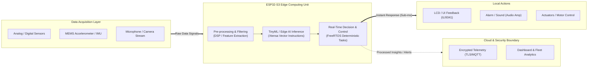

# ND01 — Week 01: ปฐมนิเทศ พื้นฐาน Edge AI & IoT และสภาพแวดล้อมการจำลอง

> **โครงการบัณฑิตพันธุ์ใหม่ (Non-Degree) รุ่นที่ 2 ประจำปี 2569 — มจธ. (KMUTT)**  
> **หลักสูตร ND01:** นักพัฒนาอุปกรณ์ Edge AI และ IoT ที่มีความปลอดภัย (Edge AI and Secure IoT Device Developer)  
> **ผู้สอน:** ผศ. ดร. สันติ นุราช (Asst. Prof. Dr. Santi Nuratch) | INC-KMUTT

---

## การนำทาง (Navigation)
- [🏠 กลับหน้าสารบัญหลัก (Main Index)](../README.md)
- **Week 01 (หน้านี้)** | [Week 02 →](../week02/README.md) | [Week 03 →](../week03/README.md) | [Week 04 →](../week04/README.md)

---

## สารบัญเนื้อหา (Table of Contents)
1. [ภาพรวมสัปดาห์ที่ 1 (Overview)](#1-ภาพรวมสัปดาห์ที่-1-overview)
2. [วัตถุประสงค์โครงการและเกณฑ์การประเมินผล](#2-วัตถุประสงค์โครงการและเกณฑ์การประเมินผล)
3. [แนวคิด Edge AI vs Cloud AI ในระบบสมองกลฝังตัว](#3-แนวคิด-edge-ai-vs-cloud-ai-ในระบบสมองกลฝังตัว)
4. [การจำลองระบบก่อนลงบอร์ดจริง (Simulation-First Paradigm)](#4-การจำลองระบบก่อนลงบอร์ดจริง-simulation-first-paradigm)
5. [Infographic: โครงสร้างสถาปัตยกรรม Edge AI Pipeline](#5-infographic-โครงสร้างสถาปัตยกรรม-edge-ai-pipeline)
6. [สรุปผลการเรียนรู้ประจำสัปดาห์ที่ 1 (Key Takeaways)](#6-สรุปผลการเรียนรู้ประจำสัปดาห์ที่-1-key-takeaways)

---

## 1. ภาพรวมสัปดาห์ที่ 1 (Overview)

สัปดาห์แรกเป็นการเปิดประตูสู่วงการ **Edge AI และ Secure IoT** โดยมุ่งเน้นการสร้างความเข้าใจในเป้าหมายของหลักสูตร โครงสร้างการเรียนรู้ตลอดหลักสูตร เกณฑ์การฝึกอบรม และการปรับกรอบแนวคิด (Mindset) สู่การพัฒนาอุปกรณ์อัจฉริยะที่ปลายทางเครือข่ายโดยเริ่มจากการจำลองการทำงานอย่างเป็นระบบ

---

## 2. วัตถุประสงค์โครงการและเกณฑ์การประเมินผล

- **เป้าหมายหลัก:** ผลิตวิศวกรและนักพัฒนาระบบที่มีความเชี่ยวชาญในการออกแบบ พัฒนา และดูแลความปลอดภัยของอุปกรณ์ Edge AI และ IoT ที่ใช้งานได้จริงในภาคอุตสาหกรรม
- **เกณฑ์การสำเร็จการอบรมและรับบอร์ด:**
  1. การส่งมอบชิ้นงานและการบ้านครบทุกชิ้นงานตามที่ได้รับมอบหมายในระบบ
  2. การเช็คชื่อเข้าร่วมการเรียนรู้ออนไลน์ไม่น้อยกว่า 4 ครั้ง จากทั้งหมด 6 ครั้ง
  3. สิทธิประโยชน์การได้รับบอร์ดฝึกอบรมไมโครคอนโทรลเลอร์ **ESP32-S3** ที่มาพร้อมจอแสดงผลสี IPS ขนาด 2.8 นิ้ว (Capacitive Touch) สำหรับผู้เรียนที่ปฏิบัติตามเกณฑ์
  4. การคัดเลือกและจัดสรรที่นั่งเข้าร่วมอบรมภาคปฏิบัติการแบบ Onsite ณ อาคาร KX Knowledge Xchange ชั้น 10

---

## 3. แนวคิด Edge AI vs Cloud AI ในระบบสมองกลฝังตัว

ในการพัฒนาระบบอัจฉริยะแบบดั้งเดิม การประมวลผลโมเดล AI มักจะส่งข้อมูลทั้งหมด (เช่น ข้อมูลเซนเซอร์ ภาพถ่าย เสียง) ขึ้นไปประมวลผลบนเซิร์ฟเวอร์คลาวด์ (Cloud Computing) ซึ่งก่อให้เกิดข้อจำกัดหลายประการ:

| มิติเปรียบเทียบ | Cloud AI (ประมวลผลบนคลาวด์) | Edge AI (ประมวลผลที่อุปกรณ์ปลายทาง) |
|---|---|---|
| **แบนด์วิดท์เครือข่าย (Bandwidth)** | ส่งข้อมูลดิบตลอดเวลา สร้างภาระแก่เครือข่ายสูงมาก | ส่งเฉพาะผลลัพธ์ (Insights) หรือสัญญาณแจ้งเตือน ประหยัดแบนด์วิดท์ |
| **เวลาแฝง (Latency & Jitter)** | ขึ้นอยู่กับความเร็วอินเทอร์เน็ต มีความไม่แน่นอนสูง | ตอบสนองระดับมิลลิวินาที (Sub-ms / Deterministic) |
| **ความเป็นส่วนตัว (Data Privacy)** | ข้อมูลดิบเสี่ยงต่อการถูกดักจับหรือรั่วไหลระหว่างทาง | ข้อมูลประมวลผลจบในตัวชิป ไม่ต้องส่งข้อมูลส่วนบุคคลออกนอกอุปกรณ์ |
| **การทำงานแบบออฟไลน์ (Offline)** | หากอินเทอร์เน็ตล่ม ระบบหยุดทำงานทันที | ทำงานตัดสินใจอัตโนมัติได้แม้ไม่มีสัญญาณเครือข่าย |

การเปลี่ยนผ่านสู่ **Edge AI** คือการย้ายงานอนุมานโมเดล (Inference) มาทำงานบนตัวไมโครคอนโทรลเลอร์ปลายทางโดยตรง ช่วยลดแบนด์วิดท์ ตัดปัญหาเวลาแฝง รักษาความลับของข้อมูล และเพิ่มความเสถียรของระบบควบคุม

---

## 4. การจำลองระบบก่อนลงบอร์ดจริง (Simulation-First Paradigm)

ก่อนที่จะได้รับบอร์ดหรือลงมืออัดโปรแกรมลงฮาร์ดแวร์ ผู้เรียนได้รับการปลูกฝังกระบวนการคิดแบบ **Simulation-First**:
- การจำลองการทำงานของอัลกอริทึมและ FreeRTOS API บนคอมพิวเตอร์ส่วนบุคคล (Host Simulator / Visual Lab)
- การใช้โปรแกรมจำลอง เช่น Wokwi หรือ Visual PC Workshop เพื่อตรวจสอบความถูกต้องของลอจิก, ลำดับการเรียกฟังก์ชัน, สเตตแมชชีน (State Machine) และการบริหารจัดการทรัพยากร
- **ประโยชน์สำคัญ:** ลดเวลาการค้นหาจุดบกพร่อง (Debugging Time) จากปัญหาทางกายภาพ เช่น สายหลวม ปัญหาพอร์ตสื่อสาร หรือเฟิร์มแวร์แครชที่ไม่ทราบสาเหตุ ทำให้เมื่อลงบอร์ดจริงสามารถโฟกัสกับฮาร์ดแวร์ได้อย่างเต็มที่

---

## 5. Infographic: โครงสร้างสถาปัตยกรรม Edge AI Pipeline

---

## 6. สรุปผลการเรียนรู้ประจำสัปดาห์ที่ 1 (Key Takeaways)

1. เข้าใจโครงสร้างหลักสูตร เป้าหมาย และเกณฑ์การประเมินผลของโครงการบัณฑิตพันธุ์ใหม่ ND01
2. วิเคราะห์ข้อได้เปรียบของ **Edge AI** เหนือกว่า **Cloud AI** ทั้งในด้าน Latency, Bandwidth, Privacy และ Offline Reliability
3. เข้าใจกระบวนการพัฒนาเฟิร์มแวร์สมัยใหม่ด้วยแนวคิด **Simulation-First** เพื่อตรวจสอบความถูกต้องของซอฟต์แวร์ก่อนนำลงฮาร์ดแวร์จริง

---
[🏠 กลับหน้าสารบัญหลัก](../README.md) | [ไปต่อ Week 02: สถาปัตยกรรมชิป ESP32-S3R8 และบอร์ด ES3C28P →](../week02/README.md)
