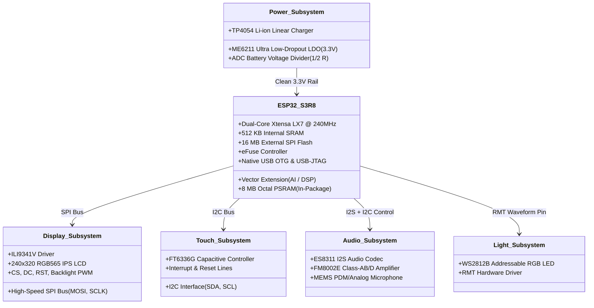
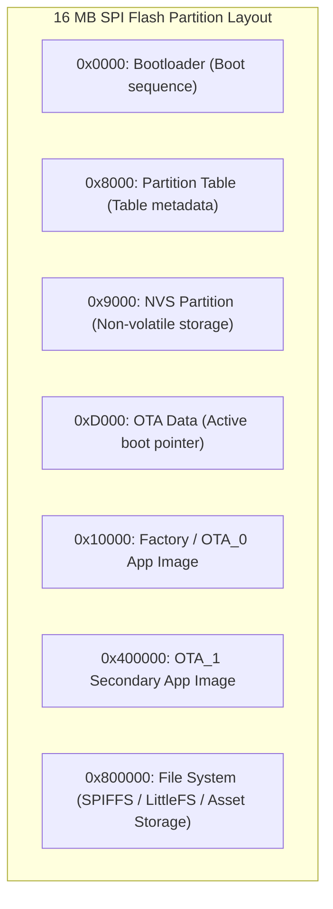

# ND01 — Week 02: สถาปัตยกรรมชิป ESP32-S3R8 ฮาร์ดแวร์ ES3C28P และวงจรเชื่อมต่อ


> **โครงการบัณฑิตพันธุ์ใหม่ (Non-Degree) รุ่นที่ 2 ประจำปี 2569 — มจธ. (KMUTT)**  
> **หลักสูตร ND01:** นักพัฒนาอุปกรณ์ Edge AI และ IoT ที่มีความปลอดภัย (Edge AI and Secure IoT Device Developer)  
> **ผู้สอน:** ผศ. ดร. สันติ นุราช (Asst. Prof. Dr. Santi Nuratch) | INC-KMUTT

---

## การนำทาง (Navigation)
- [🏠 กลับหน้าสารบัญหลัก (Main Index)](../README.md)
- [← Week 01](../week01/README.md) | **Week 02 (หน้านี้)** | [Week 03 →](../week03/README.md) | [Week 04 →](../week04/README.md)

---

## สารบัญเนื้อหา (Table of Contents)
1. [ภาพรวมสัปดาห์ที่ 2 (Overview)](#1-ภาพรวมสัปดาห์ที่-2-overview)
2. [สถาปัตยกรรมชิป ESP32-S3 (Xtensa Dual-Core & Vector Extension)](#2-สถาปัตยกรรมชิป-esp32-s3-xtensa-dual-core--vector-extension)
3. [ระบบหน่วยความจำเชิงลึก (ROM, SRAM, Octal PSRAM, Flash, eFuse)](#3-ระบบหน่วยความจำเชิงลึก-rom-sram-octal-psram-flash-efuse)
4. [หน่วยความจำในมุมมองเฟิร์มแวร์ (Stack, Heap, MALLOC_CAP, Partition Table, NVS)](#4-หน่วยความจำในมุมมองเฟิร์มแวร์-stack-heap-malloc_cap-partition-table-nvs)
5. [กับดัก USB-Serial และระบบจ่ายพลังงาน](#5-กับดัก-usb-serial-และระบบจ่ายพลังงาน)
6. [โมดูลอุปกรณ์ต่อพ่วงบนบอร์ด ES3C28P](#6-โมดูลอุปกรณ์ต่อพ่วงบนบอร์ด-es3c28p)
7. [ทบทวนแกนหลัก Embedded C และมโนทัศน์ FreeRTOS](#7-ทบทวนแกนหลัก-embedded-c-และมโนทัศน์-freertos)
8. [สรุปผลการเรียนรู้ประจำสัปดาห์ที่ 2 (Key Takeaways)](#8-สรุปผลการเรียนรู้ประจำสัปดาห์ที่-2-key-takeaways)

---

## 1. ภาพรวมสัปดาห์ที่ 2 (Overview)

สัปดาห์ที่ 2 เป็นการศึกษาเชิงลึกในระดับฮาร์ดแวร์ของบอร์ดหลักสูตร **ES3C28P** ผ่านเนื้อหา 15 บทเรียนอย่างเป็นระบบ ตั้งแต่ซิลิคอน สถาปัตยกรรมหน่วยความจำ วงจรภาคจ่ายไฟ อุปกรณ์ต่อพ่วงทุกชิ้น จนถึงความรู้พื้นฐานของ Embedded C เพื่อเตรียมความพร้อมก่อนเขียนเฟิร์มแวร์ควบคุมฮาร์ดแวร์จริง



---

## 2. สถาปัตยกรรมชิป ESP32-S3 (Xtensa Dual-Core & Vector Extension)

- **ซีพียูคู่ (Dual-Core):** ขับเคลื่อนด้วยโปรเซสเซอร์ Xtensa® Dual-core 32-bit LX7 ทำงานที่ความเร็วสัญญาณนาฬิกาสูงสุด 240 MHz (Core 0: Protocol CPU, Core 1: Application CPU)
- **ชุดคำสั่งเวกเตอร์ (Vector Instructions):** คุณสมบัติเด่นของ ESP32-S3 คือการเพิ่มคำสั่งประมวลผลเวกเตอร์ระดับฮาร์ดแวร์ (Vector Extensions / SIMD) เช่น คำสั่งคูณ-สะสม (Multiply-Accumulate: MAC) 8-bit และ 16-bit ช่วยเร่งความเร็วการคำนวณโครงข่ายประสาทเทียม (Neural Networks) และการประมวลผลสัญญาณดิจิทัล (DSP) เร็วกว่า ESP32 รุ่นแรกหลายเท่า
- **ความปลอดภัยฮาร์ดแวร์ (Security Engine):** รองรับระบบ Secure Boot, Flash Encryption (AES-128/256-XTS), การจัดการคีย์ด้วย eFuse และ Digital Signature Peripheral

---

## 3. ระบบหน่วยความจำเชิงลึก (ROM, SRAM, Octal PSRAM, Flash, eFuse)

ESP32-S3 ผสมผสานหน่วยความจำหลากหลายชนิด แต่ละประเภทมีคุณสมบัติและหน้าที่แตกต่างกันอย่างชัดเจน:

| ชนิดหน่วยความจำ | ขนาด | ความเร็ว/การเชื่อมต่อ | ลักษณะการใช้งาน |
|---|---|---|---|
| **Internal ROM** | 384 KB | บนชิป (On-chip) | เก็บ First-Stage Bootloader, ฟังก์ชันพื้นฐานของไดรเวอร์ฮาร์ดแวร์ |
| **Internal SRAM** | 512 KB | On-chip (Zero Latency) | แบ็กเอนด์ของ DMA, FreeRTOS Kernel, ISR Stack, Task Stack วิกฤต |
| **External PSRAM** | 8 MB | Octal SPI (OPI) ในชิป | หน่วยความจำขยายสำหรับ Framebuffer ของจอ LCD, บัฟเฟอร์เสียง I2S, และโมเดล AI |
| **External Flash** | 16 MB | Quad/Octal SPI | เก็บ Second-Stage Bootloader, Partition Table, อิมเมจเฟิร์มแวร์, ข้อมูล NVS |
| **eFuse** | 4096 bits | วันไทม์โปรแกรม (One-Time Programmable) | บันทึก MAC Address, Chip Configuration, กุญแจความปลอดภัย (Root of Trust) |

---

## 4. หน่วยความจำในมุมมองเฟิร์มแวร์ (Stack, Heap, MALLOC_CAP, Partition Table, NVS)

- **Stack vs Heap:** แต่ละ Task ใน FreeRTOS จะมี Stack ส่วนตัวที่ถูกจัดสรรตอนสร้างทาสก์ ขณะที่ Heap เป็นพื้นที่ส่วนกลางสำหรับฟังก์ชันตระกูล `malloc()`
- **Memory Capabilities (`heap_caps_malloc`):** เนื่องจากหน่วยความจำภายใน (SRAM) มีจำกัดแต่ทำงานเร็วมาก และรองรับ Direct Memory Access (DMA) ในขณะที่ PSRAM มีพื้นที่มากแต่มีความหน่วงและต่อผ่านแคช ESP-IDF จึงออกแบบระบบ Multi-heap:
  ```c
  // ตัวอย่างการจองหน่วยความจำภายในที่รองรับ DMA (สำหรับ SPI Framebuffer)
  uint8_t *dma_buf = heap_caps_malloc(1024, MALLOC_CAP_DMA | MALLOC_CAP_INTERNAL);

  // ตัวอย่างการจองพื้นที่ขนาดใหญ่ใน PSRAM สำหรับเก็บข้อมูลประมวลผล
  float *model_weights = heap_caps_malloc(1024 * 1024, MALLOC_CAP_SPIRAM);
  ```
- **ตารางพาร์ทิชัน (Partition Table):** กำหนดการแบ่งส่วนของ Flash หน่วยความจำ 16MB เพื่อแยกพื้นที่อย่างปลอดภัย ได้แก่ Bootloader, Partition Table, NVS (จัดเก็บค่าตั้งค่าแบบ Key-Value), OTADATA (ข้อมูลเลือกเฟิร์มแวร์ active), OTA_0, OTA_1 (สำหรับเฟิร์มแวร์หลักและสำรอง) และ Storage สำหรับระบบไฟล์ SPIFFS/LittleFS



---

## 5. กับดัก USB-Serial และระบบจ่ายพลังงาน

- **Native USB vs External UART Chip:** บอร์ด ES3C28P และโมดูลสมัยใหม่จำนวนมากใช้ช่องทาง Native USB-Serial/JTAG ของ ESP32-S3 โดยตรง (ต่อที่ขา GPIO19 และ GPIO20) โดยไม่มีชิป USB-UART ภายนอก (เช่น CP2102 หรือ CH340):
  * **กับดักฮาร์ดแวร์ (Trap):** เมื่อชิปเกิดข้อผิดพลาดรุนแรง (Panic/Crash) หรือถูกสั่งเข้าสู่โหมดหลับลึก (Deep Sleep) ช่องทางการเชื่อมต่อ USB เสมือนจะขาดหายไปจากคอมพิวเตอร์ ทำให้โปรแกรม Serial Monitor ค้างและไม่สามารถตรวจเช็กพอร์ตได้
  * **การแก้ไข:** ต้องกดปุ่ม **BOOT** ค้างไว้ แล้วกดปุ่ม **RESET** หนึ่งครั้ง จากนั้นปล่อยปุ่ม BOOT เพื่อบังคับชิปให้เข้าสู่โหมด ROM Bootloader เพื่อให้ระบบตรวจพบพอร์ต COM และแฟลชโปรแกรมใหม่ได้
- **ระบบจ่ายไฟและวัดแบตเตอรี่:**
  * ชิปชาร์จแบตเตอรี่ลิเธียม **TP4054** ทำงานแบบ Linear Constant Current / Constant Voltage ชาร์จผ่านแรงดัน 5V จากพอร์ต USB
  * ตัวปรับแรงดันไฟฟ้าคงที่ **LDO (Low-Dropout Regulator)** แปลงแรงดันไฟเลี้ยง 5V หรือแรงดันแบตเตอรี่ (3.0V – 4.2V) ให้กลายเป็นไฟเลี้ยงระบบ 3.3V ที่เรียบและเสถียร
  * **วงจรแบ่งแรงดัน (Voltage Divider):** เนื่องจากขา ADC ของ ESP32-S3 รองรับแรงดันไม่เกิน 3.3V (และมีความเป็นเชิงเส้นดีที่สุดในช่วง 0 – 2.5V) จึงต้องใช้วงจรแบ่งแรงดันผ่านตัวต้านทาน 2 ตัว เพื่อลดทอนแรงดันของแบตเตอรี่ลงครึ่งหนึ่งก่อนส่งเข้าขา ADC เพื่อคำนวณเปอร์เซ็นต์แบตเตอรี่คงเหลือ

---

## 6. โมดูลอุปกรณ์ต่อพ่วงบนบอร์ด ES3C28P

1. **จอภาพ ILI9341V (2.8" SPI Display 240×320):** ขับเคลื่อนด้วยบัส SPI สัญญาณความถี่สูง รองรับชุดสี RGB565 (16-bit per pixel) พร้อมสายควบคุม Data/Command (DC), Chip Select (CS), Reset (RST) และ Backlight Control
2. **ระบบสัมผัส FT6336G:** ควบคุมระบบจอสัมผัสแบบเก็บประจุ (Capacitive Touch) สื่อสารผ่านบัส I2C ใช้สายข้อมูล SDA, SCL และสาย Interrupt (INT) แจ้งเตือนเมื่อตรวจพบการสัมผัสหรือการลากนิ้ว (Gestures)
3. **ระบบประมวลผลเสียง (Audio Chain):** ประกอบด้วย 3 ภาคสำคัญ:
   * ชิปตัวแปลงสัญญาณเสียง **ES8311 Codec** สื่อสารข้อมูลเสียงแบบดิจิทัลผ่านบัส I2S และควบคุมการทำงานผ่าน I2C
   * วงจรขยายเสียง **FM8002E** ทำหน้าที่ขับลำโพงขับเสียงขนาดเล็ก
   * ไมโครโฟนความแม่นยำสูงแบบ **MEMS Microphone** สำหรับตรวจจับเสียงสั่งการหรือวัดระดับความดัง
4. **ไฟสัญญาณ Addressable RGB LED (WS2812B):**
   * ใช้สายควบคุมเพียงเส้นเดียว (Single-Wire Interface) แต่ต้องการความแม่นยำของไทมิ่งระดับนาโนวินาที (พัลส์ช่วง High 0.4 µs สำหรับบิต 0 และ 0.8 µs สำหรับบิต 1)
   * **เหตุผลที่ต้องใช้ RMT:** ซีพียูทั่วไปไม่สามารถสร้างสัญญาณบิตแบบ Bit-banging ได้แม่นยำหากมีอินเทอร์รัปต์รบกวน บอร์ดนี้จึงใช้โมดูลฮาร์ดแวร์ **RMT (Remote Control Peripheral)** ของ ESP32-S3 ในการสร้างสัญญาณพัลส์อัตโนมัติจาก RAM โดยไม่กินเวลาของซีพียู
5. **MicroSD Card Interface:** บอร์ดต่อใช้งานในโหมด **SDIO 4-bit (Data 0–3, CLK, CMD)** ซึ่งให้ความเร็วและแบนด์วิดท์ในการอ่านเขียนไฟล์สูงกว่าการเชื่อมต่อแบบ SPI 1-bit แบบเก่าหลายเท่าตัว
6. **แผนที่การใช้งานขา (Expansion Header & Pin Map):**
   * บอร์ดถูกออกแบบให้ขา GPIO ส่วนใหญ่ถูกใช้งานโดยอุปกรณ์ต่อพ่วงในตัว (Built-in Peripherals)
   * **ข้อห้ามเด็ดขาด:** ขา GPIO ที่ต่อกับหน่วยความจำ Octal PSRAM และ SPI Flash ภายในแพ็กเกจ (เช่น GPIO26–GPIO32) ห้ามนำมาใช้งานภายนอกเด็ดขาด มิฉะนั้นชิปจะแครชทันที
   * **Strapping Pins:** ขา GPIO0, GPIO45, GPIO46 ควบคุมโหมดการบูต ต้องระมัดระวังแรงดันขณะเปิดเครื่อง
   * ขาที่ว่างให้เชื่อมต่อภายนอก (Free Expansion Pins) มีจำนวนจำกัดประมาณ 4 ขา สำหรับเซนเซอร์เพิ่มเติม

---

## 7. ทบทวนแกนหลัก Embedded C และมโนทัศน์ FreeRTOS

- การใช้งาน Pointer ในการเข้าถึงรีจิสเตอร์ฮาร์ดแวร์โดยตรง (Memory-Mapped I/O)
- คีย์เวิร์ด `volatile` เพื่อป้องกันคอมไพเลอร์ Optimize ตัวแปรที่ค่าอาจเปลี่ยนแปลงโดยฮาร์ดแวร์หรืออินเทอร์รัปต์
- การจัดตำแหน่งหน่วยความจำ (Struct Memory Alignment and Padding) เพื่อความเร็วในการเข้าถึงข้อมูล 32-bit
- มโนทัศน์การแบ่งงานเป็นฟังก์ชันอิสระ (Concurrent Execution) แทนการเขียนโปรแกรมวนรอบลูปขนาดใหญ่ลูปเดียว

---

## 8. สรุปผลการเรียนรู้ประจำสัปดาห์ที่ 2 (Key Takeaways)

1. เข้าใจโครงสร้างสถาปัตยกรรม **ESP32-S3R8** และจุดเด่นด้านคำสั่งเวกเตอร์สำหรับงาน Edge AI
2. แยกแยะหน้าที่ของหน่วยความจำแต่ละระดับ (**ROM, Internal SRAM, Octal PSRAM, SPI Flash, eFuse**) และการจองหน่วยความจำด้วย `heap_caps_malloc()`
3. เข้าใจบัสสื่อสารและวงจรอุปกรณ์ต่อพ่วงทั้งหมดบนบอร์ด **ES3C28P** (SPI LCD, I2C Touch, I2S Audio Codec, RMT RGB LED, SDIO MicroSD) รวมถึงวิธีแก้ปัญหากับดักพอร์ต Native USB

---
[← ย้อนกลับ Week 01](../week01/README.md) | [🏠 กลับหน้าสารบัญหลัก](../README.md) | [ไปต่อ Week 03: การติดตั้ง ESP-IDF และแกนกลาง FreeRTOS →](../week03/README.md)
