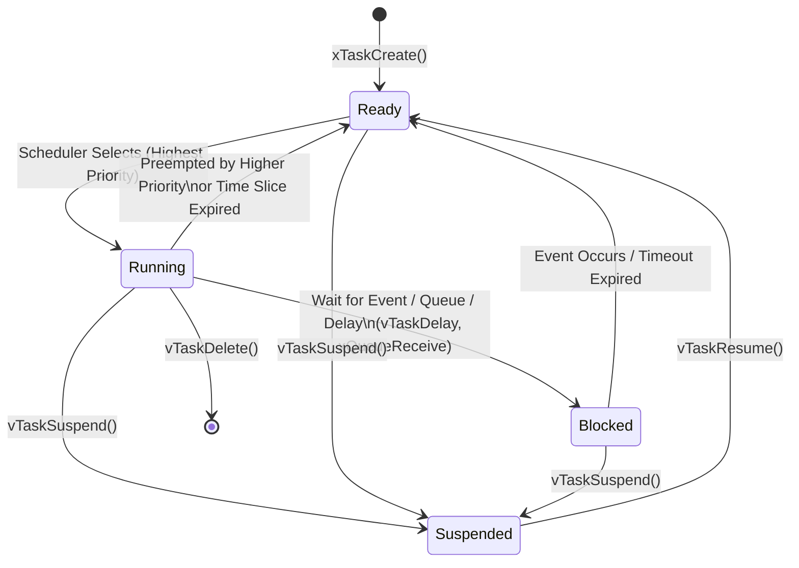
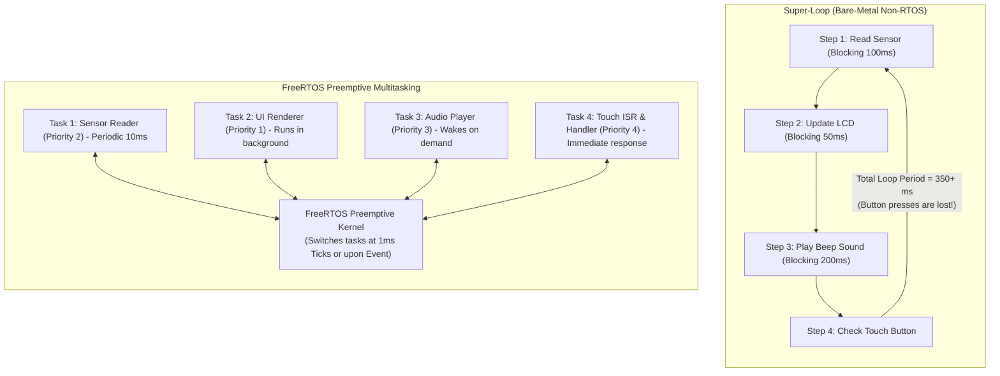

# ND01 — Week 03: การติดตั้ง ESP-IDF v6.1 และแกนกลาง FreeRTOS บนเครื่องคอมพิวเตอร์

> **โครงการบัณฑิตพันธุ์ใหม่ (Non-Degree) รุ่นที่ 2 ประจำปี 2569 — มจธ. (KMUTT)**  
> **หลักสูตร ND01:** นักพัฒนาอุปกรณ์ Edge AI และ IoT ที่มีความปลอดภัย (Edge AI and Secure IoT Device Developer)  
> **ผู้สอน:** ผศ. ดร. สันติ นุราช (Asst. Prof. Dr. Santi Nuratch) | INC-KMUTT

---

## การนำทาง (Navigation)
- [🏠 กลับหน้าสารบัญหลัก (Main Index)](../README.md)
- [← Week 01](../week01/README.md) | [← Week 02](../week02/README.md) | **Week 03 (หน้านี้)** | [Week 04 →](../week04/README.md)

---

## สารบัญเนื้อหา (Table of Contents)
1. [ภาพรวมสัปดาห์ที่ 3 (Overview)](#1-ภาพรวมสัปดาห์ที่-3-overview)
2. [สถาปัตยกรรมทูลเชน ESP-IDF](#2-สถาปัตยกรรมทูลเชน-esp-idf)
3. [ขั้นตอนการติดตั้ง ตรวจสอบ และทดสอบ Hello World](#3-ขั้นตอนการติดตั้ง-ตรวจสอบ-และทดสอบ-hello-world)
4. [ทฤษฎีระบบปฏิบัติการเวลาจริง (FreeRTOS Core Mechanics)](#4-ทฤษฎีระบบปฏิบัติการเวลาจริง-freertos-core-mechanics)
5. [การสื่อสารและการซิงโครไนซ์ระหว่างทาสก์ (IPC Mechanisms)](#5-การสื่อสารและการซิงโครไนซ์ระหว่างทาสก์-ipc-mechanisms)
6. [Infographic: วงจรชีวิตและสถานะของ Task (Task State Machine)](#6-infographic-วงจรชีวิตและสถานะของ-task-task-state-machine)
7. [Infographic: เปรียบเทียบ Super-loop กับ Preemptive Multitasking](#7-infographic-เปรียบเทียบ-super-loop-กับ-preemptive-multitasking)
8. [สรุปผลการเรียนรู้ประจำสัปดาห์ที่ 3 (Key Takeaways)](#8-สรุปผลการเรียนรู้ประจำสัปดาห์ที่-3-key-takeaways)

---

## 1. ภาพรวมสัปดาห์ที่ 3 (Overview)

สัปดาห์ที่ 3 นำผู้เรียนก้าวสู่การลงมือเซ็ตอัปเครื่องมือพัฒนาระดับมาตรฐานวิศวกรรมสากล **ESP-IDF v6.1** และศึกษาทฤษฎีเชิงลึกของเคอร์เนลระบบปฏิบัติการเวลาจริง (**FreeRTOS**) ผ่านการจำลองและฝึกเขียนโปรแกรมบนคอมพิวเตอร์ (FreeRTOS PC Workshops) ตลอดจนการทดสอบคอมไพล์โปรเจกต์ Hello World สำหรับชิป ESP32-S3

---

## 2. สถาปัตยกรรมทูลเชน ESP-IDF

ESP-IDF (Espressif IoT Development Framework) แตกต่างจากสภาพแวดล้อมอย่าง Arduino IDE อย่างสิ้นเชิง เนื่องจากเป็นเฟรมเวิร์กที่รองรับสถาปัตยกรรมระดับองค์กร:
- **Build System:** ใช้ **CMake** ร่วมกับตัวขับเคลื่อนการสร้างโปรแกรมความเร็วสูง **Ninja**
- **Compiler Toolchain:** ใช้ Cross-compiler ชุด `xtensa-esp32s3-elf-gcc` สำหรับแปลซอร์สโค้ดภาษา C/C++ เป็นภาษาเครื่องของชิป
- **Python Virtual Environment (`.espressif`):** เป็นสภาพแวดล้อมปิดสำหรับรันสคริปต์เสริมของ Espressif (เช่น `esptool.py` ในการแฟลชชิป, ตัวจัดการ Kconfig/menuconfig, สคริปต์วิเคราะห์ไบนารี) ซึ่งตัดปัญหาความไม่เข้ากันของเวอร์ชัน Python บนระบบปฏิบัติการของผู้ใช้

---

## 3. ขั้นตอนการติดตั้ง ตรวจสอบ และทดสอบ Hello World

กระบวนการติดตั้งและทดสอบบนระบบปฏิบัติการ (Windows/macOS/Linux) ดำเนินการผ่านขั้นตอนสำคัญ:
1. การเตรียมสภาพแวดล้อมด้วย Git และ Python
2. การรันสคริปต์ติดตั้งทูลสำหรับชิปเป้าหมาย: `.\install.ps1 esp32s3`
3. การเรียกใช้งานตัวแปรสภาพแวดล้อม (Export Environment Variables): `. .\export.ps1` เพื่อให้ระบบรู้จักคำสั่ง `idf.py`
4. การเปิดโปรเจกต์ `esp32-s3/main/hello_world_main.c` และดำเนินการคำสั่งมาตรฐาน:
   - `idf.py set-target esp32s3` : กำหนดชนิดสถาปัตยกรรมชิปเป้าหมาย
   - `idf.py build` : คอมไพล์และลิงก์โปรเจกต์
   - `idf.py -p COMx flash` : บันทึกไบนารีลงใน Flash ของบอร์ด
   - `idf.py -p COMx monitor` : มอนิเตอร์ข้อความจาก Serial Terminal ผ่านสาย USB
5. **ผลลัพธ์การ Bring-up:** ตรวจพบจำนวนคอร์ของซีพียู (2 Cores), ชนิดชิป ESP32-S3, ข้อมูล Revision, ขนาด Flash Memory, และทดสอบการเรียกใช้คำสั่งหน่วงเวลาของ FreeRTOS `vTaskDelay()`

---

## 4. ทฤษฎีระบบปฏิบัติการเวลาจริง (FreeRTOS Core Mechanics)

- **ทำไมต้องเปลี่ยนจาก Super-loop เป็น RTOS?**
  * ในระบบดั้งเดิมแบบลูปวนรอบเดียว (Super-loop / `while(1)`) หากมีคำสั่งใดคำสั่งหนึ่งหน่วงเวลา (เช่น รออ่านเซนเซอร์ I2C หรือสั่ง `delay()`) จะทำให้ระบบทั้งหมดหยุดการตอบสนองทันที
  * FreeRTOS ใช้กลไก **Preemptive Multitasking** โดยมี **Scheduler** คอยสลับการทำงานระหว่างทาสก์ตามลำดับความสำคัญ (Task Priority) ทำให้ทาสก์ที่มีความสำคัญสูงสุดสามารถเข้าควบคุมซีพียูได้ทันทีเมื่อมีข้อมูลพร้อม
- **System Tick Timer:** สัญญาณนาฬิกาพื้นฐานของ RTOS (SysTick) ขัดจังหวะการทำงานเป็นจังหวะคงที่ (โดยทั่วไปกำหนดไว้ที่ 100 Hz หรือ 1000 Hz) ทำให้ฟังก์ชันอย่าง `vTaskDelay()` ไม่ใช่การวนลูปเผาผลาญสัญญาณนาฬิกาแบบไร้ประโยชน์ แต่เป็นการแจ้งให้ Scheduler นำทาสก์นั้นไปพักในสถานะ **Blocked** เพื่อให้ทาสก์อื่นเข้าทำงานได้

---

## 5. การสื่อสารและการซิงโครไนซ์ระหว่างทาสก์ (IPC Mechanisms)

ในการเขียนระบบแบบหลายทาสก์ การเข้าถึงตัวแปรหรือข้อมูลร่วมกันโดยไม่มีการป้องกันจะก่อให้เกิดปัญหา **Data Race** และความเสียหายของหน่วยความจำ FreeRTOS จึงมอบเครื่องมือ IPC มาตรฐาน:

1. **คิว (Queues):**
   * โครงสร้างข้อมูลแบบ FIFO (First-In, First-Out) มีความปลอดภัยของหน่วยความจำแบบ Thread-Safe
   * คัดลอกข้อมูลโดยค่า (Copy-by-value) หรือส่งแบบ Pointer เพื่อให้ทาสก์ผู้ผลิต (Producer) ส่งข้อมูลให้ทาสก์ผู้บริโภค (Consumer) ได้อย่างเป็นระเบียบ
2. **มิวเทกซ์ (Mutex - Mutual Exclusion):**
   * ใช้ปกป้องทรัพยากรที่มีอยู่ชิ้นเดียว (เช่น พอร์ต Serial, บัส SPI หรือชิปแปลงสัญญาณเสียง)
   * มาพร้อมกลไก **Priority Inheritance** ซึ่งช่วยแก้ไขปัญหาสำคัญระดับตำนาน **Priority Inversion** (ปัญหาที่ทาสก์ความสำคัญต่ำถือครองมิวเทกซ์ และถูกทาสก์ความสำคัญปานกลางแย่งเวลา จนทำให้ทาสก์ความสำคัญสูงต้องรอคอยอย่างไม่มีกำหนด)
3. **เซมาฟอร์ (Semaphores):**
   * **Binary Semaphore:** เหมาะสำหรับการส่งสัญญาณเตือน (Signaling) ระหว่าง Interrupt Service Routine (ISR) กับ Task
   * **Counting Semaphore:** ใช้สำหรับการนับจำนวนทรัพยากรคงเหลือในระบบ หรือนับเหตุการณ์ที่เกิดขึ้นสะสม
4. **อีเวนต์กรุ๊ป (Event Groups):**
   * ใช้ชุดของบิตแฟล็ก (Bits Flag) เพื่อตรวจสอบและซิงโครไนซ์หลายเงื่อนไขพร้อมกัน เช่น "รอจนกระทั่งเชื่อมต่อ WiFi สำเร็จ AND อ่านค่าเซนเซอร์ครบถ้วน" (`xEventGroupWaitBits`)
5. **การแจ้งเตือนตรงถึงทาสก์ (Direct-to-Task Notifications):**
   * กลไกที่เบาที่สุดใน FreeRTOS โดยส่งสัญญาณตรงเข้าสู่ Task Control Block (TCB) ของทาสก์เป้าหมายโดยตรง
   * ใช้น้อยกว่าทั้ง RAM และมีค่าความหน่วงการทำงาน (Overhead) ต่ำกว่าการใช้ Semaphore ทั่วไปถึง 45%

---

## 6. Infographic: วงจรชีวิตและสถานะของ Task (Task State Machine)

---

## 7. Infographic: เปรียบเทียบ Super-loop กับ Preemptive Multitasking

---

## 8. สรุปผลการเรียนรู้ประจำสัปดาห์ที่ 3 (Key Takeaways)

1. ติดตั้งและใช้งานสภาพแวดล้อม **ESP-IDF Toolchain** (`idf.py build`, `flash`, `monitor`) ทั้งผ่านเทอร์มินัลและ VS Code Extension ได้อย่างคล่องแคล่ว
2. เข้าใจความแตกต่างระหว่างองค์ประกอบ 4 ส่วน: เฟรมเวิร์ก ESP-IDF, คอมไพเลอร์ทูลเชน, สภาพแวดล้อม Python และโปรเจกต์เฟิร์มแวร์
3. เข้าใจกลไกของ **FreeRTOS Scheduler**, สถานะของ Task (Ready, Running, Blocked, Suspended) และเครื่องมือสื่อสารระหว่างทาสก์ (**Queue, Mutex, Semaphore, Event Group, Task Notification**)

---
[← ย้อนกลับ Week 02](../week02/README.md) | [🏠 กลับหน้าสารบัญหลัก](../README.md) | [ไปต่อ Week 04: ปฏิบัติการ Onsite Workshop @ อาคาร KX →](../week04/README.md)
