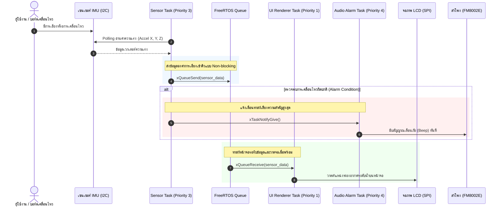
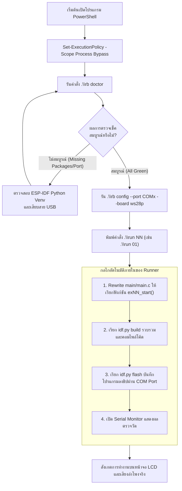

# ND01 — Week 04: ปฏิบัติการ Onsite Workshop @ อาคาร KX มจธ. (Firmware Engineering Labs)

> **โครงการบัณฑิตพันธุ์ใหม่ (Non-Degree) รุ่นที่ 2 ประจำปี 2569 — มจธ. (KMUTT)**  
> **หลักสูตร ND01:** นักพัฒนาอุปกรณ์ Edge AI และ IoT ที่มีความปลอดภัย (Edge AI and Secure IoT Device Developer)  
> **ผู้สอน:** ผศ. ดร. สันติ นุราช (Asst. Prof. Dr. Santi Nuratch) | INC-KMUTT

---

## การนำทาง (Navigation)
- [🏠 กลับหน้าสารบัญหลัก (Main Index)](../README.md)
- [← Week 01](../week01/README.md) | [← Week 02](../week02/README.md) | [← Week 03](../week03/README.md) | **Week 04 (หน้านี้)**

---

## สารบัญเนื้อหา (Table of Contents)
1. [ภาพรวมสัปดาห์ที่ 4 (Overview)](#1-ภาพรวมสัปดาห์ที่-4-overview)
2. [บรรยากาศและการจัดสภาพแวดล้อม Workshop (`rbdev` & Thin-App Architecture)](#2-บรรยากาศและการจัดสภาพแวดล้อม-workshop-rbdev--thin-app-architecture)
3. [เจาะลึกปฏิบัติการ Device Labs (ex00 – ex06)](#3-เจาะลึกปฏิบัติการ-device-labs-ex00--ex06)
4. [ปฏิบัติการ Special Labs (ex01 – ex06): FreeRTOS Patterns เชิงลึก](#4-ปฏิบัติการ-special-labs-ex01--ex06-freertos-patterns-เชิงลึก)
5. [ส่วนประกอบเสริม: UI/Widget Demos และ RTOS Game Capstones](#5-ส่วนประกอบเสริม-uiwidget-demos-และ-rtos-game-capstones)
6. [Infographic: สถาปัตยกรรมมัลติทาสก์ของระบบตรวจวัดและเตือนภัย](#6-infographic-สถาปัตยกรรมมัลติทาสก์ของระบบตรวจวัดและเตือนภัย)
7. [Infographic: เวิร์กโฟลว์การทดลองและการสลับแล็บด้วยระบบ `rbdev` Runner](#7-infographic-เวิร์กโฟลว์การทดลองและการสลับแล็บด้วยระบบ-rbdev-runner)
8. [สรุปผลการเรียนรู้ประจำสัปดาห์ที่ 4 (Key Takeaways)](#8-สรุปผลการเรียนรู้ประจำสัปดาห์ที่-4-key-takeaways)

---

## 1. ภาพรวมสัปดาห์ที่ 4 (Overview)

ในสัปดาห์ที่ 4 เป็นการอบรมภาคปฏิบัติการแบบ **Onsite Workshop** เต็มวัน ณ อาคารเคเอกซ์ (KX Knowledge Xchange) มจธ. โดย ผศ. ดร. สันติ นุราช ซึ่งเป็นการนำความรู้ด้านฮาร์ดแวร์จากสัปดาห์ที่ 2 และพื้นฐาน RTOS จากสัปดาห์ที่ 3 มาประยุกต์เขียนเฟิร์มแวร์อุปกรณ์ตรวจวัดและเครื่องมือที่นำไปใช้งานจริงบนบอร์ด ESP32-S3

---

## 2. บรรยากาศและการจัดสภาพแวดล้อม Workshop (`rbdev` & Thin-App Architecture)

- **เครื่องมือจัดการเฉพาะกิจ (`rbdev` CLI):** ผู้สอนได้พัฒนาเครื่องมือช่วยบริหารการพัฒนาเฟิร์มแวร์เพื่อให้นักศึกษาสามารถโฟกัสที่การเขียนโปรแกรม FreeRTOS โดยไม่ต้องเสียเวลากับการคอมฟิกไฟล์ CMake ใหม่ทุกครั้ง:
  * `.\rb doctor` : ระบบวินิจฉัยสภาพแวดล้อม ตรวจสอบทูลเชน พอร์ตสื่อสาร และแพ็กเกจ Python
  * `.\rb config --port COMx --board ws28p` (หรือ `es3c28p`) : บันทึกค่าพอร์ตและรุ่นของบอร์ดลงใน `.rbdev.toml`
  * `.\run NN` : สคริปต์สลับแบบฝึกหัดอัตโนมัติ โดยสคริปต์จะแก้ไขไฟล์ `main/main.c` ให้เรียกชุดการทดลอง `exNN` ที่ต้องการ แล้วดำเนินการคอมไพล์ แฟลช และเปิดหน้าจอมอนิเตอร์ในคำสั่งเดียว
- **แนวคิด Thin-App Architecture:** เฟิร์มแวร์ระดับล่าง ไดรเวอร์จอ LCD สัมผัส วงจรถอดรหัสเสียง และชุดวิดเจ็ตกราฟิกถูกคอมไพล์สำเร็จรูปไว้ในคลังโปรแกรม `librobotos_fw.a` ทำให้นักศึกษาเขียนโค้ดแอปพลิเคชันส่วนบนเพียงเล็กน้อย (บางเบา: Thin App) โดยมุ่งเน้นไปที่การออกแบบทาสก์และการแก้ปัญหาด้านเวลา

---

## 3. เจาะลึกปฏิบัติการ Device Labs (ex00 – ex06)

หัวใจของ Workshop คือปรัชญาการเรียนรู้:  
> **"สร้างอุปกรณ์จริง (Build Device) → สังเกตเห็นข้อบกพร่องทางกายภาพ (Hit Real Problem) → แก้ไขด้วยโครงสร้าง FreeRTOS (Solve with FreeRTOS)"**

| Lab | อุปกรณ์ที่พัฒนา | ปัญหาที่พบในระบบแบบดั้งเดิม | การแก้ไขปัญหาด้วย FreeRTOS Pattern |
|---|---|---|---|
| **ex00** | **Hello Device** | การเริ่มต้นใช้งานระบบ Bring-up จอภาพ, เสียง, และสัมผัสพร้อมกัน | สร้างทาสก์แยกส่วนและใช้ **Direct-to-Task Notification** ซิงโครไนซ์ |
| **ex01** | **Spirit Level (ระดับน้ำดิจิทัล)** | การอ่านค่า Accelerometer ผ่าน I2C ใช้เวลา ทำให้การวาดภาพหลอดระดับน้ำบนจอ LCD หน่วงและกระตุก | แยกเป็น **Sensor Task** (อ่านค่า IMU ต่อเนื่อง) ส่งข้อมูลผ่าน **Queue** ไปยัง **UI Task** (วาดภาพอิสระ) |
| **ex02** | **Motion Alarm (ระบบกันขโมย)** | การวนลูปสั่งส่งเสียงร้องบี๊ป (Beep tone) บล็อกซีพียู ทำให้ระบบไม่สามารถตรวจจับการเคลื่อนไหวใหม่ได้ทันท่วงที | ส่งสัญญาณจากตรวจจับผ่าน **Queue** ไปปลุก **Audio Task** ที่รอทำงานแบบ Asynchronous |
| **ex03** | **Reaction Game (เกมทดสอบปฏิกิริยา)** | การใช้ Busy-wait วนลูปจับเวลา ทำให้กินพลังงานซีพียู 100% และตรวจจับการกดปุ่มไม่แม่นยำ | ควบคุมด้วย **FreeRTOS Software Timer** และเปลี่ยนผ่านสถานะเกมด้วย **State Machine + Task Notify** |
| **ex04** | **Metronome (เครื่องเคาะจังหวะ)** | การใช้คำสั่งหน่วงเวลาร่วมกับการเรนเดอร์ภาพบนหน้าจอทำให้เกิด **Jitter** สัญญาณเสียงเคาะจังหวะคลาดเคลื่อน | สร้าง **Dedicated Tick Task** ที่ทำงานบนคาบเวลาคงที่ระดับความแม่นยำสูง ไม่ถูกหน่วงโดยการวาดภาพบนจอ |
| **ex05** | **Vibration Scope (สโคปวัดแรงสั่น)** | ข้อมูลตัวอย่างจากเซนเซอร์ถูกส่งเข้ามาเร็วกว่าความเร็วที่จอภาพสามารถวาดได้ (Producer เร็วกว่า Consumer) | จัดโครงสร้าง **Ring Buffer / Circular Queue** รองรับ Producer-Consumer เพื่อจัดการบัฟเฟอร์สัญญาณ |
| **ex06** | **Task Monitor (หน้าจอมอนิเตอร์ระบบ)** | ขาดการติดตามสุขภาพของระบบ ไม่ทราบการใช้งานหน่วยความจำของแต่ละทาสก์ | ดึงค่าสถิติจากเคอร์เนล (`vTaskList`, `uxTaskGetStackHighWaterMark`) แสดงผลบนจอ LCD แบบเรียลไทม์ |

---

## 4. ปฏิบัติการ Special Labs (ex01 – ex06): FreeRTOS Patterns เชิงลึก

นอกจาก Device Labs แล้ว ยังมีปฏิบัติการเสริมที่ออกแบบมาเพื่อทดสอบกรณีขอบ (Edge Cases) ของ FreeRTOS:
1. **ex01 Mutex Protection:** ทดลองให้สองทาสก์แย่งกันส่งสัญญาณเสียงผ่านลำโพง พบว่าหากไม่มีการล็อก เสียงจะขาดและซ้อนทับกัน เมื่อนำ **Mutex** มาคลุมการใช้งาน อุปกรณ์สามารถเล่นเสียงได้อย่างสมบูรณ์
2. **ex02 Boot ISR to Task:** การเชื่อมต่อปุ่ม BOOT (GPIO0) เข้ากับระบบอินเทอร์รัปต์ โดย ISR จะส่งสัญญาณผ่านฟังก์ชันที่ลงท้ายด้วย `...FromISR` (`vTaskNotifyGiveFromISR`) พร้อมการสั่ง Context Switch ทันทีหากทาสก์ที่ตื่นขึ้นมามีลำดับความสำคัญสูงกว่า
3. **ex03 Priority Starvation & `taskYIELD()`:** แสดงปรากฏการณ์ที่ทาสก์ความสำคัญสูงวนลูปประมวลผลโดยไม่ยอมคืนเวลา (Starving lower-priority tasks) และการแก้ไขด้วยการกำหนดช่วงเวลาพักหรือเรียกฟังก์ชัน `taskYIELD()` เพื่อปล่อยให้ทาสก์อื่นสลับเข้าทำงาน
4. **ex04 Counting Semaphore:** การจำลองการบริหารจัดการพูลทรัพยากรที่มีจำนวนจำกัด
5. **ex05 Event Group Multi-Synchronization:** การตรวจสอบสภาวะที่ต้องรอสัญญาณพร้อมกันหลายชุด
6. **ex06 Auto-reload Software Timers:** การตั้งค่าตัวจับเวลาอัตโนมัติสำหรับการสุ่มตัวอย่างในพื้นหลัง

---

## 5. ส่วนประกอบเสริม: UI/Widget Demos และ RTOS Game Capstones

- **UI & Widget Catalog (`demos/demo-labs/` ex01–ex17):** การเรียนรู้คอมโพเนนต์ส่วนติดต่อผู้ใช้ เช่น Label, LED indicator, Terminal console, Switch, Button, Slider, Checkbox, Radio, Form, Log viewer, Circular Gauge, Progress Bar, Live Waveform Chart และการเรนเดอร์มุมระนาบ 3 มิติของเซนเซอร์ IMU (3D IMU Visualization)
- **FreeRTOS Game Capstones (`rtos-labs/` ex11–ex15):** การนำรูปแบบ FreeRTOS ทั้งหมดมาผสานสร้างเป็นวิดีโอเกมเชิงตอบสนองบนจอสี 2.8 นิ้ว เช่น เกมขับรถควบคุมด้วยความเอียงของบอร์ด (IMU Racer), เกมทำลายบล็อก (Brick Break), เกมยานอวกาศ (Space Shoot), เกมหลบอุกกาบาต (Asteroids) และเกมพากบข้ามถนน (Frogger) เพื่อพิสูจน์ความเสถียรของเฟิร์มแวร์ภายใต้โหลดการประมวลผลสูง

---

## 6. Infographic: สถาปัตยกรรมมัลติทาสก์ของระบบตรวจวัดและเตือนภัย

---

## 7. Infographic: เวิร์กโฟลว์การทดลองและการสลับแล็บด้วยระบบ `rbdev` Runner

---

## 8. สรุปผลการเรียนรู้ประจำสัปดาห์ที่ 4 (Key Takeaways)

1. ลงมือปฏิบัติการจริงบนบอร์ด ESP32-S3 โดยใช้เครื่องมือ `rbdev` และโครงสร้าง **Thin-App Architecture**
2. แก้ปัญหาทางวิศวกรรมในอุปกรณ์จริง (I/O Blocking, Jitter, Producer-Consumer Speed Mismatch, Shared Peripheral Contention) ด้วยสถาปัตยกรรม **FreeRTOS**
3. ประยุกต์ใช้ Queue, Mutex, Software Timer, ISR Notification และ Task Monitoring ในการสร้างอุปกรณ์วัดผลและเกมเชิงตอบสนองแบบเวลาจริง

---
[← ย้อนกลับ Week 03](../week03/README.md) | [🏠 กลับหน้าสารบัญหลัก](../README.md)
